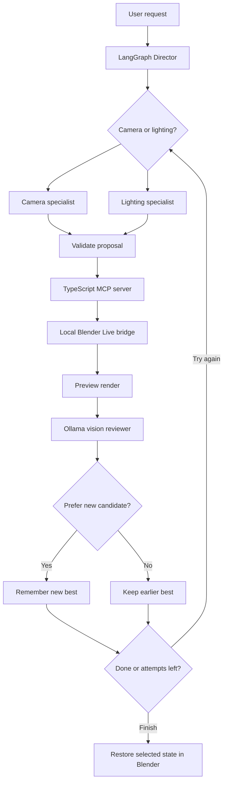

# FramePilot

**A local, MCP-powered assistant for camera and lighting adjustments in Blender.**

FramePilot connects a running Blender scene to AI tools through a TypeScript [Model Context Protocol (MCP)](https://modelcontextprotocol.io/) server. An experimental Python/LangGraph workflow uses a local Ollama model to plan camera or lighting adjustments, render low-resolution previews, compare them with the previous best image, and retain the preferred result.

It started as an MCP learning project and is now a **working prototype**, not a finished autonomous art director. The system can operate on different Blender scenes; artistic judgments remain subjective and need human review.

## What it does

- **Inspect the open scene:** list objects, inspect individual objects and lights, read the active camera and render settings.
- **Control Blender live:** update camera transforms and existing light properties in the Blender window through a local bridge.
- **Plan with specialized roles:** a LangGraph Director routes tasks to a Camera or Lighting agent.
- **Compare real renders:** a vision-capable Ollama model evaluates a candidate preview against the current best, gives feedback, and selects a preferred variant.
- **Keep experiments reversible:** editing is opt-in (`--apply`), the workflow records evaluation results, and it attempts to restore the selected camera and light state at the end. Changes are **not saved automatically** to your `.blend` file.

### Architecture



The Blender add-on receives authenticated localhost commands and performs Blender API operations on Blender's main thread. The MCP server communicates with clients over stdio. For implementation details and caveats, see [Architecture](docs/ARCHITECTURE.md).

## Quick start (macOS + Blender)

**Prerequisites:** Blender 4.2+ (developed around Blender 5.2), Node.js 20+, Python and [Ollama](https://ollama.com/). A local vision-capable model is required for the automatic image comparison. Blender and Ollama run on the same computer.

### 1. Install dependencies

```bash
npm install
npm run check
python3 -m venv agent/.venv
source agent/.venv/bin/activate
pip install -r agent/requirements.txt
ollama pull qwen3.5:4b
```

Start the Ollama desktop app (or `ollama serve` if not already running).

### 2. Enable the live integration

The repository already contains the v1 MCP tool registration. On a fresh setup, the installer scripts are safe to rerun:

```bash
node scripts/enable-live.mjs
node scripts/enable-v1.mjs
npm run check
```

Install `addons/framepilot_live.py` through Blender's add-on preferences, **or** on macOS use:

```bash
node scripts/install-v1-addon.mjs 5.2
```

Restart Blender after installing/updating the add-on. Open a copy of your own `.blend` file, ensure an active camera is selected, open the 3D Viewport's **N sidebar > FramePilot**, set the project path if necessary, and click **Start Live Bridge**. Verify that the Blender window reports an active connection.

### 3. Inspect without an LLM or edits

```bash
python agent/v1.py --inspect
```

This prints scene, camera, objects, and lights from the open Blender window. It does **not** call Ollama, render, or modify the scene.

### 4. Preview a plan (no edits)

```bash
python agent/v1.py \
  "Improve the lighting while preserving the current composition." \
  --model qwen3.5:4b
```

### 5. Run a short visual comparison

```bash
python agent/v1.py \
  "Make the lighting more atmospheric without blowing out highlights on the main subject." \
  --model qwen3.5:4b \
  --vision-model qwen3.5:4b \
  --apply --attempts 2
```

`--apply` allows edits to the **currently open** Blender scene; run it only on a copy or a scene you are comfortable modifying. The workflow makes a baseline render, evaluates candidate previews, and attempts to restore the preferred camera/light configuration. Review the result before manually saving in Blender.

Runs are stored under `runtime/v1_runs/<timestamp>/` (`baseline.png`, `attempt_01.png`, etc., plus `evaluation.json`). `runtime/` is ignored by Git. See [Demo and evaluation](docs/DEMO.md).

## MCP tools

| Tool | Purpose |
| --- | --- |
| `inspect_scene` | Read scene summary and active camera |
| `list_scene_objects` / `get_object` | Read object inventory or details |
| `list_lights` | Inspect existing light objects |
| `set_camera` / `set_camera_pose` | Move or restore the active camera |
| `set_light_properties` | Change a named existing light |
| `render_preview` | Render a 480 × 270 preview |
| `create_light` | Manually create a new light with explicit authorization; **not** used by automatic v1 |

The original Codex MCP demo and headless Blender workflow are still present, but **`agent/v1.py` requires the live Blender bridge**. To use the MCP server from Codex CLI, run `npm run setup:codex` and restart Codex; it is not needed to run the Python v1 agent.

## Scope and limitations

- Automatic v1 adjusts the **active camera or one existing light per proposal**. It does not yet edit materials, Geometry Nodes or mesh geometry, and does not automatically create lights.
- The Director chooses a camera or lighting specialist; this is task routing, not unrestricted tool execution.
- The vision reviewer compares 480 × 270 rendered images with the stated artistic goal. Its feedback is qualitative, **not a guarantee of improved composition**.
- Scene inventory does not prove render visibility; poorly lit geometry can be invisible in a preview.
- Restoration is best-effort for camera and lights touched by the agent. It is not a replacement for a saved backup or Blender Undo.
- Preview rendering may temporarily block Blender, and running Blender and Ollama together may require substantial memory.

## Development checks

```bash
npm run check
source agent/.venv/bin/activate
python -m unittest discover -s agent/tests -v
```

These are static/type and local unit checks; real end-to-end testing requires Blender Live and Ollama. The prototype has been exercised with both a generated test scene and a separate user-created scene, but it has not been exhaustively tested across arbitrary `.blend` files.

## Project structure

```text
src/server.ts               MCP server and legacy tools
src/v1_tools.ts             Generic v1 MCP tool definitions
src/live.ts                 Authenticated localhost bridge client
addons/framepilot_live.py   Blender add-on, scene operations and live server
agent/v1.py                 LangGraph director / specialists / vision reviewer
agent/v1_core.py            Validation and candidate-selection helpers
agent/tests/               Offline tests
scripts/                   Demo generation and setup helpers
runtime/                   Local previews and evaluation logs (gitignored)
```
